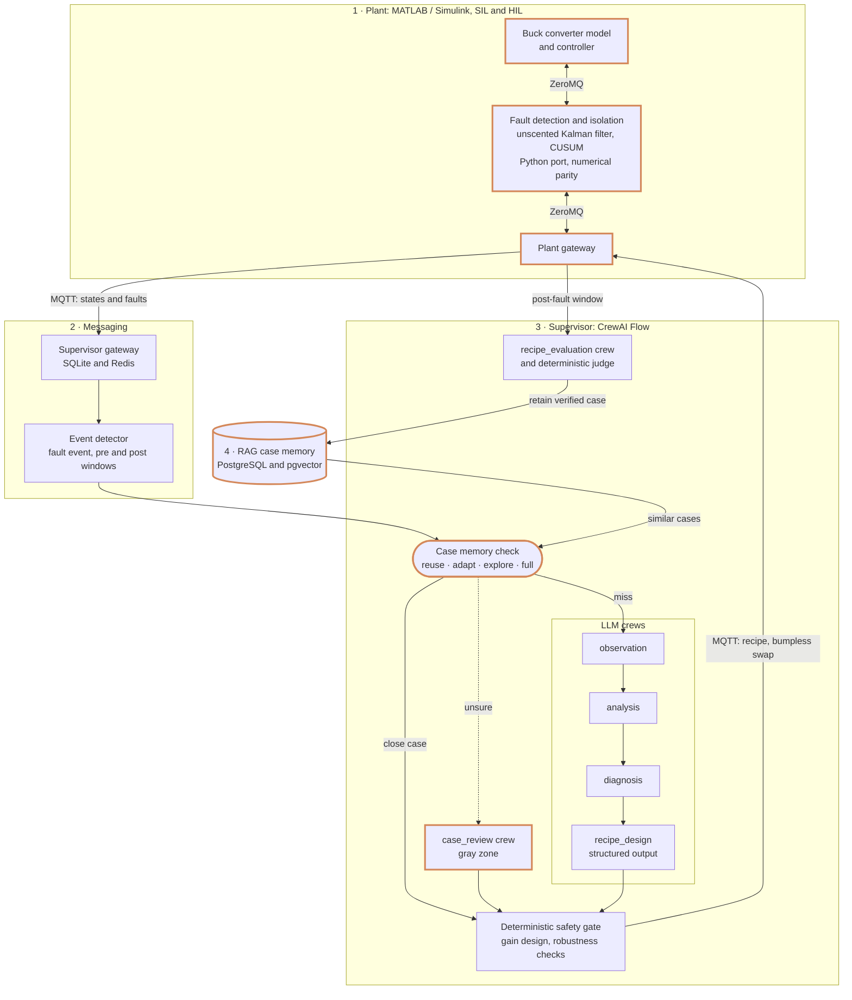
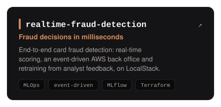
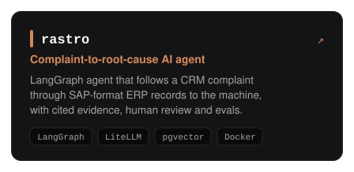
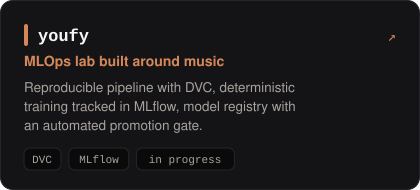
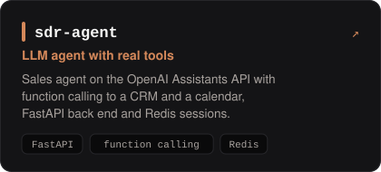

<picture><source media="(prefers-color-scheme: dark)" srcset="https://raw.githubusercontent.com/Oseiasdfarias/Oseiasdfarias/develop/assets/banner-dark.svg?v=3"><source media="(prefers-color-scheme: light)" srcset="https://raw.githubusercontent.com/Oseiasdfarias/Oseiasdfarias/develop/assets/banner-light.svg?v=3"></picture>

 

I build AI systems that keep physical systems running: they detect when something fails and help fix it, in production. I come from electrical engineering and industrial maintenance, so I care about the system around the model, not only the model.

**Machine Learning & AI Engineer (MLOps)** · Brazil · open to remote roles · [Portfolio](https://oseiasdfarias.github.io) · [CV (EN)](https://oseiasdfarias.github.io/Oseias_Farias_CV_EN.pdf) · [CV (PT)](https://oseiasdfarias.github.io/Oseias_Farias_CV_PT.pdf) · [LinkedIn](https://www.linkedin.com/in/oseiasfarias/)

<picture><source media="(prefers-color-scheme: dark)" srcset="https://raw.githubusercontent.com/Oseiasdfarias/Oseiasdfarias/develop/assets/section-highlights-dark.svg?v=3"><source media="(prefers-color-scheme: light)" srcset="https://raw.githubusercontent.com/Oseiasdfarias/Oseiasdfarias/develop/assets/section-highlights-light.svg?v=3"></picture>

| **Top 5%** | **1st author** | **−76%** | **90.5%** |
|:--|:--|:--|:--|
| in Tractian's ML Engineering hiring process, up to the final stage | of a paper at CBA 2026, the Brazilian Automation Conference | LLM calls with the RAG case memory in the UFABC · AFOSR research | of fraud stopped by [realtime-fraud-detection](https://github.com/Oseiasdfarias/realtime-fraud-detection) (synthetic data) |

<picture><source media="(prefers-color-scheme: dark)" srcset="https://raw.githubusercontent.com/Oseiasdfarias/Oseiasdfarias/develop/assets/section-experience-dark.svg?v=3"><source media="(prefers-color-scheme: light)" srcset="https://raw.githubusercontent.com/Oseiasdfarias/Oseiasdfarias/develop/assets/section-experience-light.svg?v=3"></picture>

- **AI Engineer & Researcher · UFABC** (Apr 2025 – present), in a project funded by the U.S. Air Force Office of Scientific Research (AFOSR): a supervisor where **LLM agents** (CrewAI) close the loop with a power converter behind a deterministic safety gate. I built the **RAG-style case memory** (PostgreSQL + pgvector), which retrieves similar faults and reuses validated recipes (−76% LLM calls), and the **Simulink plant** in software/hardware-in-the-loop with its fault detection (**unscented Kalman filter**, CUSUM). A journal paper on the architecture is in preparation.

<b>UFABC supervisor architecture, end to end</b> (the parts I built have an orange border)

With the memory on, a paired campaign used **76% fewer LLM calls** and delivered the recipe about 0.4 s sooner in plant time.

- **Founder & Lead Engineer · [Otensor](https://docs.otensor.com.br)** (Jun 2026 – present): an IoT automation platform that connects ESP32 and Raspberry Pi devices to a real-time dashboard and an event-driven automation engine on AWS.
- **Backend & AI Developer · Verzel** (Dec 2025 – Jun 2026): voice AI and multi-tenant integrations for Lunella, an AI agent platform (Java/Quarkus, Vue.js, GraphQL, AWS serverless).
- **Education:** M.Sc. in Electrical and Information Engineering at UFABC (expected 2027); M.Sc. in Applied Computing at UFPA (2025–2027); B.Sc. in Electrical Engineering at UFPA (2024).

<picture><source media="(prefers-color-scheme: dark)" srcset="https://raw.githubusercontent.com/Oseiasdfarias/Oseiasdfarias/develop/assets/section-projects-dark.svg?v=3"><source media="(prefers-color-scheme: light)" srcset="https://raw.githubusercontent.com/Oseiasdfarias/Oseiasdfarias/develop/assets/section-projects-light.svg?v=3"></picture>

<a href="https://github.com/Oseiasdfarias/realtime-fraud-detection"><picture><source media="(prefers-color-scheme: dark)" srcset="https://raw.githubusercontent.com/Oseiasdfarias/Oseiasdfarias/develop/assets/card-fraud-detection-dark.svg?v=4"><source media="(prefers-color-scheme: light)" srcset="https://raw.githubusercontent.com/Oseiasdfarias/Oseiasdfarias/develop/assets/card-fraud-detection-light.svg?v=4"></picture></a>
<a href="https://github.com/Oseiasdfarias/rastro-agent"><picture><source media="(prefers-color-scheme: dark)" srcset="https://raw.githubusercontent.com/Oseiasdfarias/Oseiasdfarias/develop/assets/card-rastro-dark.svg?v=3"><source media="(prefers-color-scheme: light)" srcset="https://raw.githubusercontent.com/Oseiasdfarias/Oseiasdfarias/develop/assets/card-rastro-light.svg?v=3"></picture></a>
<a href="https://github.com/Oseiasdfarias/youfy"><picture><source media="(prefers-color-scheme: dark)" srcset="https://raw.githubusercontent.com/Oseiasdfarias/Oseiasdfarias/develop/assets/card-youfy-dark.svg?v=3"><source media="(prefers-color-scheme: light)" srcset="https://raw.githubusercontent.com/Oseiasdfarias/Oseiasdfarias/develop/assets/card-youfy-light.svg?v=3"></picture></a>
<a href="https://github.com/Oseiasdfarias/oseias_desafio_elite_dev_ia"><picture><source media="(prefers-color-scheme: dark)" srcset="https://raw.githubusercontent.com/Oseiasdfarias/Oseiasdfarias/develop/assets/card-sdr-agent-dark.svg?v=3"><source media="(prefers-color-scheme: light)" srcset="https://raw.githubusercontent.com/Oseiasdfarias/Oseiasdfarias/develop/assets/card-sdr-agent-light.svg?v=3"></picture></a>

<picture><source media="(prefers-color-scheme: dark)" srcset="https://raw.githubusercontent.com/Oseiasdfarias/Oseiasdfarias/develop/assets/section-stack-dark.svg?v=3"><source media="(prefers-color-scheme: light)" srcset="https://raw.githubusercontent.com/Oseiasdfarias/Oseiasdfarias/develop/assets/section-stack-light.svg?v=3"></picture>

**AI & ML** 
        

**Cloud & back end** 
         

**Physical systems** 
    

<picture><source media="(prefers-color-scheme: dark)" srcset="https://raw.githubusercontent.com/Oseiasdfarias/Oseiasdfarias/develop/assets/section-research-dark.svg?v=3"><source media="(prefers-color-scheme: light)" srcset="https://raw.githubusercontent.com/Oseiasdfarias/Oseiasdfarias/develop/assets/section-research-light.svg?v=3"></picture>

- **Farias, O. D.**, Estrada Martínez, E., Lescano, J. C. O. S., Potts, A. S. *Supervisão Adaptativa de Conversor Buck por Sistema Multiagente com Ciclo Percepção-Raciocínio-Ação e Reconfiguração Autônoma de Controladores*. Brazilian Conference on Automation (CBA), 2026. **Presented.**
- **Farias, O. D.**, Teixeira, R. B. *FCS-MPC com ARX Adaptativo via RLS para Controle P-Q Robusto a Variações Paramétricas em Inversores Trifásicos Conectados à Rede*. Brazilian Conference on Automation (CBA), 2026. **Presented.**
- Cota, Y. O., **Farias, O. D.**, Teixeira, R. B., Bayma, R. S. *Explorando o potencial do Laboratório Virtual de Controle de Sistemas com VPython no ensino de Engenharia*. COBENGE, 2023.

<picture><source media="(prefers-color-scheme: dark)" srcset="https://raw.githubusercontent.com/Oseiasdfarias/Oseiasdfarias/develop/assets/section-teaching-dark.svg?v=3"><source media="(prefers-color-scheme: light)" srcset="https://raw.githubusercontent.com/Oseiasdfarias/Oseiasdfarias/develop/assets/section-teaching-light.svg?v=3"></picture>

- **Udemy:** 2 Python courses for beginners, 2,100+ students.
- **YouTube:** [@otensor](https://youtube.com/@otensor), 1.7k subscribers.
- **Medium:** a 16-article series on MLOps, model serving, RAG and AI observability ([@oseiasfarias](https://medium.com/@oseiasfarias)).

<picture><source media="(prefers-color-scheme: dark)" srcset="https://raw.githubusercontent.com/Oseiasdfarias/Oseiasdfarias/develop/assets/section-connect-dark.svg?v=3"><source media="(prefers-color-scheme: light)" srcset="https://raw.githubusercontent.com/Oseiasdfarias/Oseiasdfarias/develop/assets/section-connect-light.svg?v=3"></picture>

     

  <picture>
    <source media="(prefers-color-scheme: dark)" srcset="https://raw.githubusercontent.com/Oseiasdfarias/Oseiasdfarias/output/snake-dark.svg">
    <source media="(prefers-color-scheme: light)" srcset="https://raw.githubusercontent.com/Oseiasdfarias/Oseiasdfarias/output/snake-light.svg">
    
  </picture>

